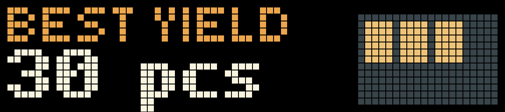
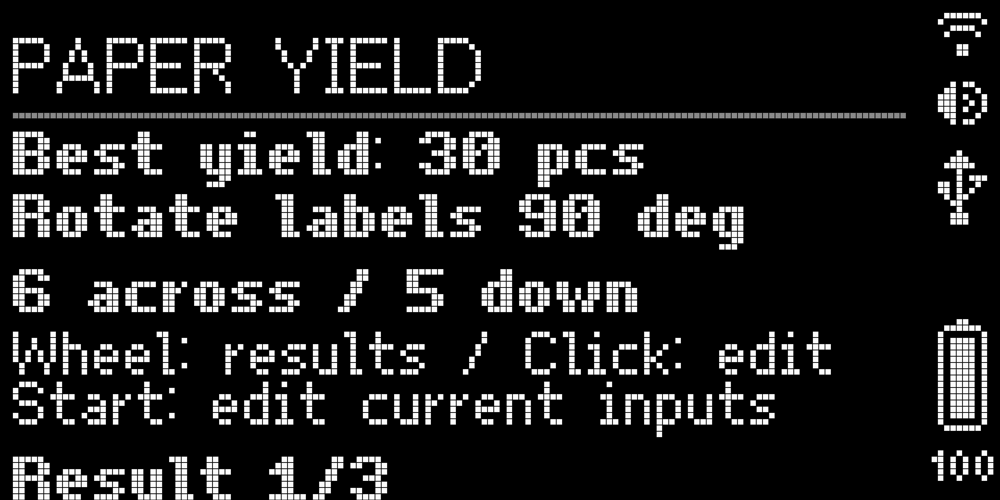

# Paper Yield

Compare both cutting orientations and find the better rectangular label yield per sheet.

Turning every label through 90 degrees can save a sheet. Paper Yield compares the two regular grids with the same margins and cutter gap, then shows how the winning grid is laid out.

The small sheet previews the upper-left corner of each cutting layout. The tiles rotate with the selected orientation. The front number and rear row and column counts give the yield for the entire sheet.

## Screen transitions

Change the label orientation and stock size, then read the yield.



<details>

<summary>Watch the rear display</summary>



</details>

## Compare label orientations

1. Enter sheet width and height, label width and height, outside margin and gap in millimeters. Click to move through fields, turn to change a value, then press **Start**.
2. Read **Best yield**. The rear tells you the orientation and grid dimensions.
3. Turn through **Upright** and **Rotated** to check both counts. The recorded example goes from 30 best to 27 upright.


## Try a different stock size

1. Click from the results to enter the sheet editor. Adjust width or advance to height if the stock size has changed.
2. Return to the results. Recheck the indicated orientation before laying out the sheet for cutting.
3. The example briefly changes a 210 mm sheet to 211 mm, restores it and returns to the 30-piece result.


## Example from the emulator

On 210×297 mm stock with 5 mm margins, the usable rectangle is 200×287 mm. A uniform grid of 50×30 mm labels and 2 mm gaps gives three by nine upright or six by five rotated. The calculator compares these two uniform grids.

## Run in the emulator

Open BUSY Bar Emulator. From this repository, run:

```sh
~/.busy-emulator/bin/busy-emulator dev --once
```

Press **Back** to exit.

The GIFs are excerpts from the emulator recording. Each LED occupies a 16 × 16 cell with a black border. The end frames pause for reading.

[Full recording](media/controls.mp4) · [Rear display](screenshots/back-1.png) · [Firmware test](EMULATOR-QA.md) · [MIT license](LICENSE)
